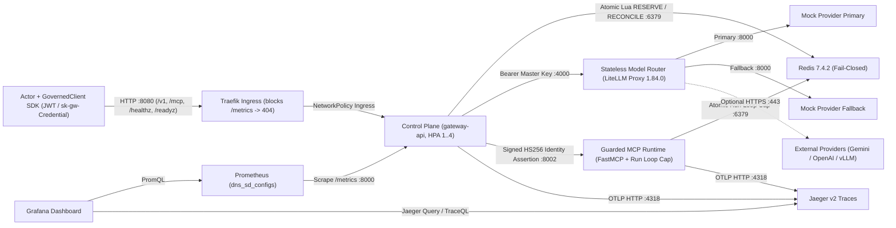

# AI Enablement Gateway

Production-style **AI Enablement Gateway** platform: a governed LLM **Control Plane** (`gateway-api`), stateless **Model Router** (`litellm-proxy`), zero-trust **Guarded MCP Runtime** (`mcp-runtime`), Python SDK (`gateway-sdk`), and atomic Redis **Budget Quota** store deployed on Kubernetes (local `Kind` + `Calico` + `Traefik` and ephemeral `GCP GKE Autopilot`) via Helm and Terraform.

## Architecture



### Core Capabilities
- **Single Governed Front Door (`gateway-api`):** Authenticates `Authorization: Bearer` **Credentials** (RS256/HS256 JWT or SHA-256 hashed `sk-gw-` API keys) into an **Actor** (`actor_id`, `team`, `role`), enforces **Team** **Model Alias** RBAC and immutable GitOps **Policy Bundles** (`policies/policy-bundle.yaml`), executes pre-call PII redaction (`[REDACTED_EMAIL]`, `[REDACTED_PHONE]`, `[REDACTED_SSN]`) and prompt-injection blocking (`403 prompt_denied`), and emits privacy-safe JSON **Audit Events** (never raw prompts or PII).
- **Atomic Reserve-Then-Reconcile Quotas:** Reserves worst-case **LLM Token** spend (`prompt_tokens + max_tokens`) in Redis Lua before forwarding, reconciles actual usage across JSON completions and zero-buffer SSE streams (including disconnect cleanup), and fails closed with `503` if Redis is unreachable.
- **Stateless Model Router (`litellm-proxy`):** YAML-only OSS LiteLLM Proxy holding **Provider** API keys and handling multi-**Provider** translation, retries, and primary-to-fallback failover (`X-Fallback-Used: true`).
- **Zero-Trust Guarded MCP Runtime (`mcp-runtime`):** Zero external Ingress; cryptographically verifies short-lived HS256 identity assertions from the **Control Plane**, enforces **Role**- and **Team**-scoped **MCP Tool** allowlists (`check_model_catalog`, `query_runbook`, `lookup_service_slo`), per-call timeouts, and Redis-backed **Run** loop limits (`429 mcp_run_loop_cap_exceeded`).

## Quickstart

Prerequisites: `docker`, `uv`, `kind`, `kubectl`, `helm`, `terraform`, and `k6` (`brew install k6` or `grafana/k6` Docker fallback).

```bash
# 1. Generate deterministic local Credentials (.local/credentials.json & local.tfvars.json)
make dev-creds

# 2. Build custom images & provision Kind + Calico + metrics-server + Traefik + Observability + Helm chart
make up ENABLE_OBSERVABILITY=true

# 3. Run the 15-check live smoke suite (auth, RBAC, PII, SSE, failover, 429, /mcp, NetworkPolicy, Prom/Grafana/Jaeger)
make smoke
uv run python scripts/smoke_test.py --check-observability

# 4. Run the interactive / recordable 9-step walkthrough demo
./scripts/demo.sh          # interactive (pause between steps)
./scripts/demo.sh --auto   # non-interactive CI/recording mode

# 5. Execute live k6 benchmarks + HPA scale-out and update benchmarks/results/latest-summary.json
make bench

# 6. Tear down local Kind cluster cleanly
make down
```

Ephemeral cloud deployment on GCP GKE Autopilot (single-region, Workload Identity, optional Gemini **Provider**):

```bash
make gcp-up GCP_PROJECT_ID=<your-project-id>
make gcp-down GCP_PROJECT_ID=<your-project-id>
```

Static validation, unit tests, and security gates:

```bash
make lint      # ruff check/format, Policy Bundle alias cross-validation, helm lint, terraform fmt
make test      # offline unit & contract pytest suite
make checkov   # Checkov IaC & rendered Kubernetes manifest security scans
make trivy     # Trivy CVE gates on custom images + LiteLLM SARIF report
```

## Security & `NetworkPolicy` Threat Model

Enforced at runtime by Calico CNI on Kind and Dataplane V2 on GKE Autopilot (`default-deny` ingress/egress across `ai-gateway` and `observability` namespaces):

| Workload | Allowed Ingress | Allowed Egress | Threat Mitigated |
| :--- | :--- | :--- | :--- |
| `gateway-api` (**Control Plane**) | `traefik` (`:8000`), `observability` (`:8000` `/metrics`) | `litellm-proxy:4000`, `mcp-runtime:8002`, `redis:6379`, DNS `:53`, OTLP `:4317/:4318` | Blocks direct bypass to **Providers** (`mock-llm-primary` probe verified blocked); Traefik omits `/metrics` (`404` externally) |
| `litellm-proxy` (**Model Router**) | `gateway-api` (`:4000`) | `mock-llm-primary:8000`, `mock-llm-fallback:8000`, DNS `:53`, optional HTTPS `:443` | Isolates **Provider** API keys and external internet egress to a single stateless component |
| `mcp-runtime` (**MCP Runtime**) | `gateway-api` (`:8002`) | `redis:6379`, DNS `:53`, OTLP `:4317/:4318` | Zero external Ingress; blocks `litellm-proxy:4000` and `1.1.1.1:443` egress; requires signed internal identity assertion |
| `mock-llm-*` (**Mock Providers**) | `litellm-proxy` (`:8000`) | None (deny all) | Prevents unauthorized direct **Control Plane** or **MCP Runtime** calls |
| `redis` (**Budget Quota** store) | `gateway-api` (`:6379`), `mcp-runtime` (`:6379`) | None (deny all) | Prevents external or router tampering with quota and **Run** counters |
| `observability` (`prometheus`, `grafana`, `jaeger`) | OTLP from `ai-gateway` (`:4317/:4318`), internal Grafana/Prometheus | `ai-gateway` `:8000` (headless `dns_sd_configs`), DNS `:53` | Zero Kubernetes API `ClusterRole` (`automountServiceAccountToken: false`) |

All custom containers run non-root (`UID 10001`), `readOnlyRootFilesystem: true`, `allowPrivilegeEscalation: false`, `capabilities.drop: ["ALL"]`, and `RuntimeDefault` seccomp profile.

## Live `k6` Benchmark Results

Measured verbatim on `2026-11-27` (`k6 v2.4.0`) against live Kind + Calico + Traefik (`http://localhost:8080`) in [`benchmarks/results/latest-summary.json`](benchmarks/results/latest-summary.json):

| Scenario | Sample Size | Success / Accuracy | Latency (p50 / p95) | Measured Outcome |
| :--- | ---: | ---: | ---: | :--- |
| **Control Plane** Overhead (`normal_json` + `sse_stream`) | `90` | `100.00%` | `3.387 ms` / `5.625 ms` | Exact `gateway_overhead_duration_seconds_bucket` delta (`mean = 3.428 ms`); PromQL across `4` HPA pods: `2.181 ms` p50 / `18.936 ms` p95 |
| Normal JSON (`POST /v1/chat/completions`) | `60` | `100.00%` | `20.477 ms` / `24.628 ms` | `4.999` RPS (`min = 6.754 ms`, `max = 47.958 ms`, `X-Fallback-Used: false`) |
| SSE Streaming (`stream: true`) | `30` | `100.00%` | `25.369 ms` / `34.599 ms` | `3.000` RPS; `text/event-stream` + `"usage"` chunk + `[DONE]` |
| Primary -> Fallback Failover (`/admin/fault`) | `13` | `100.00%` | `4743.036 ms` / `5339.048 ms` | `X-Fallback-Used: true` (`mock-llm-fallback`) during `fail_503`, then clean recovery to `mock-llm-primary` |
| **Team** RPM `429` (`product-eng`, `rpm_limit_exceeded`) | `90` | `100.00%` block accuracy | — | `60` HTTP `200` allowed, `30` HTTP `429` blocked (`0` leaks, all rate-limit headers valid) |
| **Team** Daily USD **Budget Quota** `429` (`ops-eng`, `budget_quota_exceeded`) | `30` | `100.00%` block accuracy | — | `4` HTTP `200` allowed, `26` HTTP `429` blocked (`$0.009595` limit, `$0.007715` spend, `0.0` USD leaks, `26` denials recorded) |
| HPA Sustained Scale-Out (`platform-eng` override) | `30595` | `99.997%` (`339.934` RPS) | `47.887 ms` / `95.958 ms` | CPU peaked at `489%` (`100m` request); scaled `1 -> 4` Ready replicas (`policy_restored: true`) |

## Documentation Map

- [`GLOSSARY.md`](GLOSSARY.md) — Canonical domain vocabulary (`Actor`, `Credential`, `Team`, `Role`, `Policy Bundle`, `Budget Quota`, `Control Plane`, `Model Router`, `Model Alias`, `Provider`, `LLM Token`, `MCP Tool`, `MCP Runtime`, `Run`, `Audit Event`)
- [`docs/adr/`](docs/adr/) — Architecture Decision Records (`0001`–`0006`)
- [`docs/benchmarks.md`](docs/benchmarks.md) — Detailed benchmark methodology and verbatim `k6` results
- [`docs/runbook.md`](docs/runbook.md) — 1-page operational runbook for SLO alerts, failover reset, and Helm/Terraform rollback
- [`docs/postmortem.md`](docs/postmortem.md) — Architectural trade-offs, production multi-region evolution, and real implementation incidents
